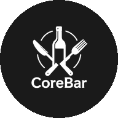
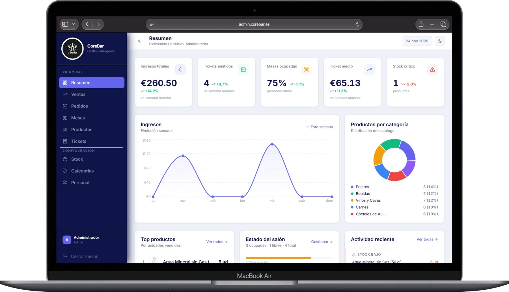
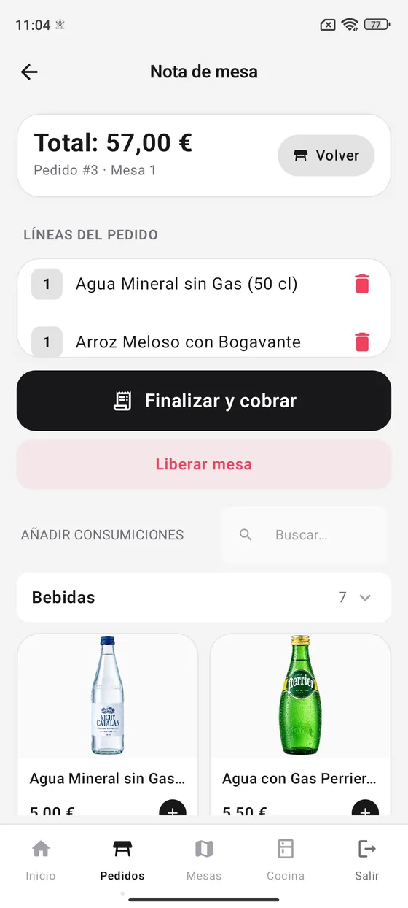
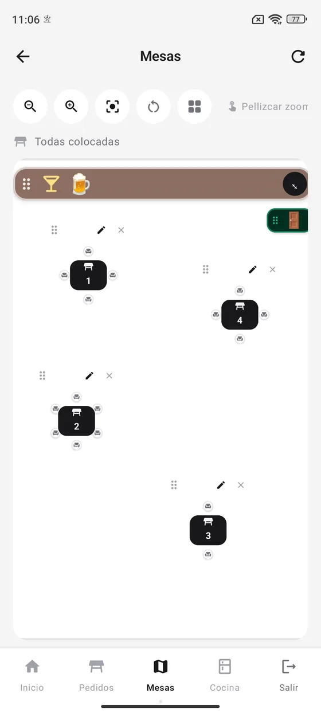
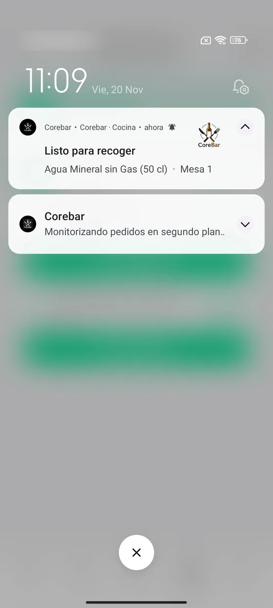
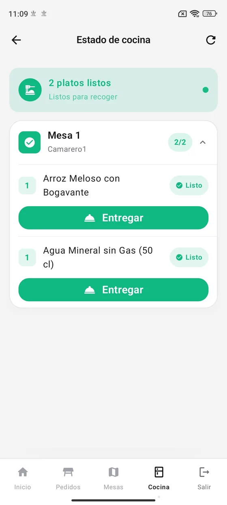
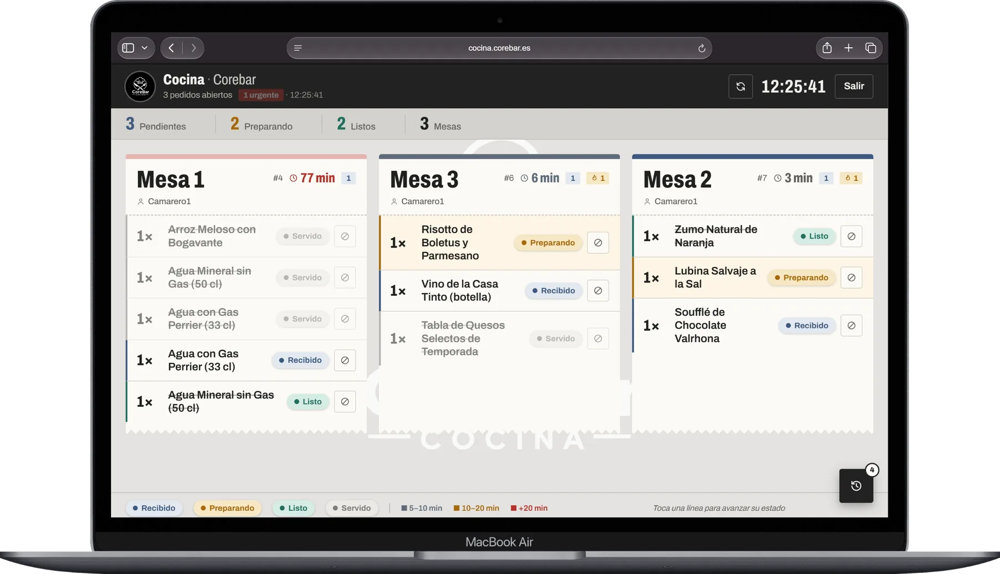
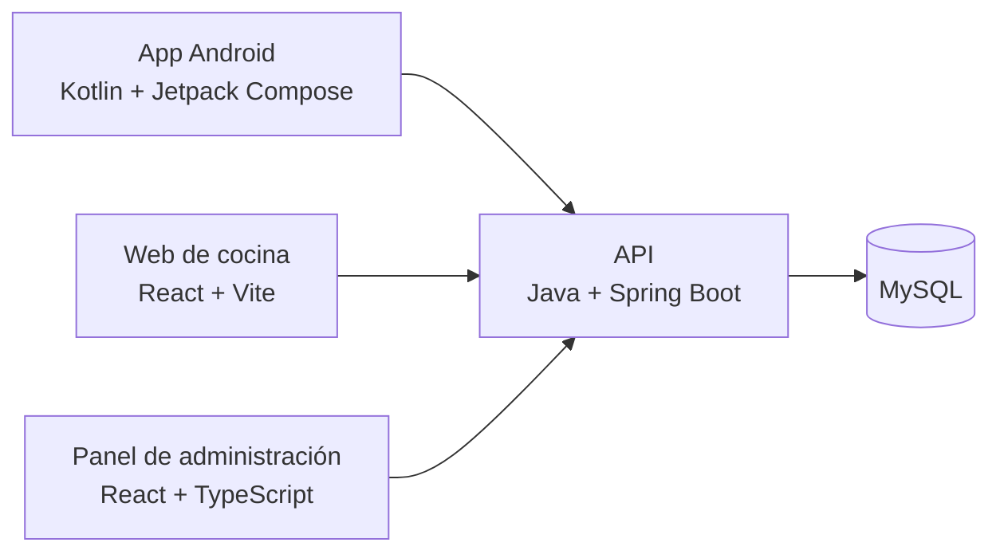

<p align="center">
  
</p>

<h1 align="center">Corebar</h1>

<p align="center">
  Gestión de restaurante: app del camarero, pantalla de cocina y panel de administración,<br>
  conectadas a una sola API.
</p>

<p align="center">
  <a href="https://github.com/DavidRamos01/corebar/actions/workflows/tests.yml"></a>
</p>

<p align="center">
  <a href="https://corebar.es"><b>corebar.es</b></a> ·
  <a href="https://demo.corebar.es">Demo del panel</a> ·
  <a href="https://cocina-demo.corebar.es">Demo de cocina</a>
</p>

Corebar es el proyecto de fin de ciclo del grado superior de **Desarrollo de Aplicaciones Multiplataforma (DAM)**, hecho por David Ramos Cordero y Sergio Ramos Cordero. Está desplegado y funcionando en un servidor propio con HTTPS.

*English: Corebar is a restaurant management system (waiter Android app, kitchen web app and admin panel) backed by one Spring Boot API. It is our final-year DAM project, deployed and running. See [English summary](#english-summary).*



## El recorrido de un pedido

1. **Recibido.** El camarero elige la mesa en la app Android, añade los platos de la carta y el pedido queda registrado en esa mesa.
2. **Preparando.** La pantalla de cocina muestra cada mesa como un ticket. Un toque pasa el plato de Recibido a Preparando y a Listo. Los pedidos nuevos aparecen solos.
3. **Listo.** El móvil del camarero avisa con «Listo para recoger», el plato y la mesa.
4. **Cobrado.** Al cobrar se emite la factura simplificada con el desglose del IVA y el panel de administración suma el ingreso a las ventas.

<p>
  
  
  
  
</p>



## Las tres aplicaciones

| Aplicación | Para quién | Carpeta |
|---|---|---|
| **Panel de administración** (React) | Quien lleva el negocio: ingresos, tickets y facturas, productos, categorías y stock, mesas y personal | [`web-admin`](web-admin) |
| **Web de cocina** (React) | Quien cocina: un ticket por mesa con los minutos de espera, colores por estado y por tiempo, historial | [`web-cocina`](web-cocina) |
| **App Android** (Kotlin) | Quien está en sala: mapa de mesas con zoom, nota de mesa con la carta y sus fotos, avisos de plato listo | [`android`](android) |

Además, [`landing`](landing) es la página de presentación de [corebar.es](https://corebar.es) y [`backend`](backend) es la API.

## Cómo está montado



- **App Android:** Kotlin y Jetpack Compose.
- **Webs:** React, TypeScript, Vite y Tailwind CSS.
- **Servidor:** Java, Spring Boot y MySQL, con autenticación por token JWT y tres roles (administrador, camarero y cocinero).
- **Despliegue:** Docker, Nginx y Let's Encrypt sobre Ubuntu.

## Probar la demo

La demo es un entorno aparte, con datos inventados. Se restablece cada noche, así que puedes tocar todo.

| Aplicación | Usuario | Contraseña |
|---|---|---|
| [Panel de administración](https://demo.corebar.es) | `admin` | `demo` |
| [Web de cocina](https://cocina-demo.corebar.es) | `cocinero1` | `demo` |

La app Android necesita instalar el APK (ver más abajo).

## Ejecutarlo en local

Necesitas Docker, Node.js 18 o superior y, para la app, Android Studio.

**1. Backend y base de datos**

```bash
cd deploy
cp .env.example .env        # rellena los valores
docker compose up -d --build
```

La API queda en `http://localhost:8080`. Las fotos de los productos las guarda la API en disco y se sirven con Nginx (ver `deploy/nginx.example.conf`), así que sin Nginx no se verán. En el primer arranque se crean las tablas, el catálogo inicial y el usuario `admin` con la contraseña de `ADMIN_INITIAL_PASSWORD`.

**2. Webs** (`web-admin` y `web-cocina` funcionan igual)

```bash
cd web-admin
npm install
npm run dev
```

Por defecto apuntan a `https://api.corebar.es`. Para usar tu API local, crea un `.env` con `VITE_API_HOST=http://localhost:8080` (hay un `.env.example`).

**3. App Android**

Abre la carpeta `android` con Android Studio. La URL de la API está en `app/build.gradle.kts` (`API_BASE_URL`). También se puede compilar el APK con GitHub Actions: en la pestaña *Actions* ejecuta **Build APK** y descarga el resultado.

## Estructura del repositorio

```
backend/     API Spring Boot (Java)
web-admin/   Panel de administración (React + TypeScript)
web-cocina/  Web de cocina (React)
android/     App del camarero (Kotlin + Jetpack Compose)
landing/     Página de presentación
deploy/      Docker Compose, variables de ejemplo y ejemplo de Nginx
docs/        Capturas
```

## Seguridad

No hay contraseñas ni claves en el repositorio. Toda la configuración sensible llega por variables de entorno (`deploy/.env.example`). Si despliegas tu propia copia, cambia todos los valores de ejemplo.

## Licencia

[PolyForm Noncommercial 1.0.0](LICENSE). Puedes leer el código, estudiarlo, probarlo y modificarlo para uso no comercial. Para cualquier uso comercial, contacta con los autores.

## English summary

Corebar connects three clients to a single Spring Boot API with a MySQL database: an Android app for the waiter (Kotlin, Jetpack Compose), a kitchen web app and an admin panel (React). An order goes from the waiter's phone to the kitchen screen and, when a dish is ready, the waiter is notified; payment issues a simplified invoice and the admin panel adds it to the sales. Live demo: [demo.corebar.es](https://demo.corebar.es) (`admin` / `demo`) and [cocina-demo.corebar.es](https://cocina-demo.corebar.es) (`cocinero1` / `demo`). Run it locally with `deploy/docker-compose.yml` and `npm run dev` in each web folder. Licensed under PolyForm Noncommercial 1.0.0.
